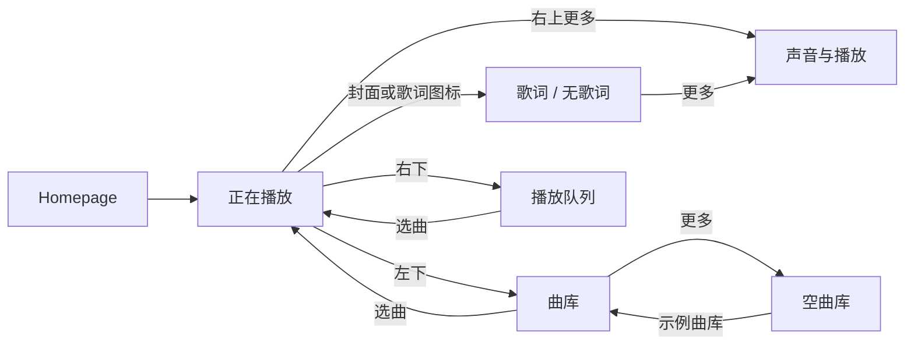

# Music：打开即听（0.4.1）

默认使用 `https://ncm-api.0x616c6f6e.icu`，地址配置在 `apps/music-player/src/config.lua`。

## 使用流程

1. 首次打开扫描二维码并在手机确认；会话分帧保存到本 APP 的私有 LittleFS 存储。
2. 下次打开自动读取已保存会话并校验 `/login/status`。有效时不再扫码，失效才重新登录。
3. 自动识别自己的“我喜欢的音乐”，加载歌曲地址并开始播放。没有每日推荐或歌单选择页。
4. 主页面显示默认封面、曲名、歌手、真实播放进度及上一首/播放暂停/下一首。
   播完自动下一首，按需加载下一批歌曲，末尾循环回第一首；上首也支持跨批和首尾循环。
5. 歌词暂时关闭：不显示 Lyrics 按钮，点击封面不进入歌词页；右上角账号页保留用户信息、会话保存状态和退出登录。
   BACK 返回播放页；在播放页 BACK 退出 APP 并停止播放。

后台使用 `/user/playlist` 查找 `specialType=5` 且 `creator.userId` 为当前用户的收藏库，
不会把第一个普通歌单或别人的收藏库误当作自己的收藏。按 6 首分批请求 `/playlist/track/all`，
由 `/song/url/v1`（standard）取得音频地址；默认不请求 `/lyric`。发现阶段每次查询 10 个歌单，最多约 1000 个。
收藏为空显示提示；无权限/无音频地址不会假装播放，可按下一首；试听歌曲显示 Preview。

## 登录保存

运行入口 `./run.ps1 -AppName music-player` 默认启用 storage、network、audio 并提供对应授权。
Cookie 保存在 `build/x86/app-data.lfs` 下本 APP UUID 的私有键中；更改 BuildDir 时使用该构建目录的介质。
不存账号密码，不把 Cookie 写入 URL 或日志。当前私有存储是本机明文，非加密凭据库。
单会话接受和持久化均支持最多 4096 字节 Cookie（最多 17 分片和 2 个元数据键）。
LittleFS 的每 APP 配额提升至 32 个键，单值仍为 255 字节；旧会话不需要迁移。
存储被拒绝或失败时显示 Session storage 错误；读取 I/O/格式错误不会触发清空和重新扫码。
写入先使提交标记失效，最后提交计数；中断不会恢复半份会话。网络失败不会清除仍可能有效的登录。
正常 BACK 退出会等待正在进行的会话保存/清除完成；强杀进程或掉电仍可能中断事务。
退出登录清空本地凭据，不影响手机；切换 API 地址不复用旧凭据。
日志 session=saved/restored 分别表示保存提交成功/已读回，storage_error 只记录错误码，不记录凭据。
升级需关闭旧 PC 进程后重新运行 run.ps1，让 Kernel 新配额和 Music 0.3.1 一起生效。

每帧最多一次存储操作，请求编码与页面重绘分帧，保留 Kernel 原有预算。
所有 API 请求都在 URL 携带防缓存 timestamp，凭据和业务参数仍在 POST body；
上游缓存不包含 POST body，仅把 timestamp 放在请求体会导致反复读到旧的 801。
日志的 qr_code=801/802/803/800 对应待扫/待确认/已授权/过期，audio 字段显示实际音频状态。

## 0.3.1 持久化回归

- 旧版在 3708 字节 Cookie 下可完成当次登录，但重启后再次请求二维码，已在本地 API fixture 复现。
- 修复后使用 4096 字节 Cookie 验证：进程重启、管理模式下退出再进入，以及保存刚开始就 BACK 退出，均恢复会话而不重复扫码。
- 验证旧格式会话可读取、读取 I/O 错误不清空凭据、显式退出登录清除凭据，以及每帧最多一次存储操作。
- 26 项 NCM 集成场景、175 项 APP 校验、193 项 Kernel 基础检查及 CTest 11/11 通过。
- 测试使用临时存储和合成账户，没有读取或改写用户运行中的 app-data.lfs；真实账户需在新进程内验证。

## 音频与当前边界

新增 Kernel `audio.playback` 接口和 Windows 后端，详见 [Audio](../../kernel/docs/audio.md)。
Windows 先将歌曲下载到临时文件，再通过默认音频设备解码播放；支持 MP3/WAV、暂停/继续、真实进度及播完状态。
下载限 32 MiB / 30 秒，保持 TLS 校验，不跟随重定向，不绕过版权/VIP限制；退出、切歌或失败会清理临时文件。
当前未接通 ESP32/I2S/CS43131 实物播放。封面仍使用默认资源；远程封面加载和逐句歌词同步尚未实现；中文歌名、歌手及歌词已由内核中文字体支持。
歌词代码保留，但默认禁用；恢复时将 `apps/music-player/src/config.lua` 的
`lyrics_enabled` 改为 `true` 并重新打包。开关同时控制歌词请求、按钮及封面点击入口。
此改动不裁剪字体，歌名、歌手和专辑仍需要中文字体。

所需 display.ui；可选 network.http、storage.private、audio.playback、input.keys、system.log。
拒绝可选能力时显示明确状态。Music 使用 Lua API 2，单 VM 上限 384 KiB，UUID 保持不变。

## 验证

- `python app/scripts/test_ncm_ui.py --runner build/x86/bin/q2_x86.exe --artifacts build/ncm-tests`
- `python app/scripts/test_ncm_scheduling.py --runner build/x86/bin/q2_x86.exe`
- CTest `q2_audio_contracts`（开启 `Q2_BUILD_AUDIO_TESTS`）。

使用临时服务、合成 Cookie、临时存储和本地生成的静音 MP3，验证扫码→保存→自动播放、独立进程恢复、
正确收藏库识别、暂停继续、切歌、播完切歌、空收藏、拒绝权限、无音频地址、错误音频、登录失效、退出清理及缓存回归。
测试不读取用户现有 Cookie，不改实际收藏；真实账号和 CDN 路径仍需用户扫码验证。

参考：[API 文档](https://neteasecloudmusicapienhanced.js.org/)；
[用户歌单接口](https://github.com/NeteaseCloudMusicApiEnhanced/api-enhanced/blob/main/module/user_playlist.js)。

---

以下为 0.1.0 的视觉原型存档（模拟播放、音量、EQ 与固定歌曲描述不适用于当前联网版本）。

# Q2 Music UI 设计与演示

## 目标与参考

为 502×410 的 Q2 播放器设计一套可运行、可点击的 Lua UI 原型，重点是封面、歌词、进度和实体按键操作。
应用名 Music，目录 `apps/music-player`，UUID `0166e1e9-2349-4e01-9301-13275b047e1f`。
已加入产品清单，可从 Homepage 启动；不是出厂常驻 APP。

查阅的主要参考为 [LVGL 官方 Music Demo](https://github.com/lvgl/lvgl/tree/master/demos/music)：
官方说明适合 480×272 / 272×480，提供音乐主视图、列表和封面频谱效果。
本设计借鉴其封面主导与播放/列表分层思路，使用 Q2 自己的 Lua 接口和原创几何封面；没有复制示例代码、封面或歌曲。
小屏首版省略频谱动画，让封面、文字与歌词保持清晰，避免与圆盘按键争夺注意力。

## 视觉规范

| 项目 | 规则 |
| --- | --- |
| 页面背景 | 深松绿 `#101C19` |
| 列表、次级控制 | `#1B2927` |
| 主文字 | 暖白 `#F1E8D5` |
| 次级文字 | 灰绿 `#98AAA0` |
| 播放、当前歌词、进度 | 暖橙 `#F0AA70` |
| 正文 / 大标题 | 现有 Montserrat 20 / 40 px |
| 页面边距 | 24 px；顶部返回与更多按钮 16 px |
| 播放键 | 64×64 px，次级播放控制 48×48 px，顶部及收藏入口 40×40 px |
| 封面 | 原始 256×256 PNG，依可用高度和宽度等比缩放，最高 180 px |
| 系统层 | 使用现有状态栏；不复制时间、电池、Wi-Fi UI，也不申请系统层权限 |

主题承接 Q2 的暖色、深色 UI。图标用统一圆形底与线形符号，封面为原创日落、潮汐、夜行几何图案。
历史原型使用英文和原创英文歌词；当前 Kernel 已支持 UTF-8 中文字体。
502×410 与 410×502 已验证；可用区域不足 380×366 时显示小屏提示与返回入口，不挤压成重叠页面。

## 页面组成

| 页面 | 内容与交互 |
| --- | --- |
| 正在播放 | 封面、歌名、歌手、格式、收藏、歌词入口；进度条、已播/总时长；曲库、上一首、播放/暂停、下一首、队列 |
| 歌词 | 顶部曲目信息、当前句高亮、前后文、进度；返回封面、播放/暂停、下一首 |
| 曲库 | 三张专辑封面缩略图、曲目、歌手、时长；选曲回播放页；底部返回当前播放 |
| 播放队列 | 当前曲目强调、队列顺序及曲目选择；更多按钮切换顺序/随机的 UI 状态 |
| 声音与播放 | 音量 ±、Flat/Warm/Vocal 预设、播放模式；明确标注 UI preview / no audio output |
| 空曲库 | 空内容引导、返回示例曲库入口；由曲库右上角更多按钮进入以审阅此状态 |
| 无歌词状态 | 第三首 Night walk 无歌词，显示 Just the music / No lyrics for this track |



返回策略：子页面回播放页；空曲库回曲库；播放页返回结束 APP 并回 Homepage。既有系统屏保、锁屏仍由 Home 管理。
原型不持续重置屏保计时器；歌词不会越过锁屏层。

## 原型状态与真实功能边界

- `src/demo.lua` 提供三首虚构歌曲与原创歌词，不读取 MP3、ID3、SD 卡或网络。
- 进度每秒模拟前进，到达末尾停下；暂停冻结，上一首/下一首和选曲重置为 0，点击进度条前进 15 秒。
  该点击仅为状态演示，尚非真实拖动 seek 或按点击比例定位。
- 歌词每 8 秒切换演示句，居中强调；没有解析或同步真实 LRC 时间轴。
- 收藏按曲目保存在本次实例内；音量、EQ、播放模式只改变界面，不发硬件请求、不修改系统配置。
  随机模式不重排队列，当前曲库仅三个示例条目，未实现搜索、扫描、分页和目录管理。
- 不接入解码、DAC、蓝牙耳机、后台音频、真实音量/EQ、文件下载或持久化。
- 必需权限仅 `display.ui`；可选 `input.keys` 和 `system.log`，拒绝后仍可用触摸/鼠标浏览。

实体键：单击 PLAY 切换演示播放，PREV/NEXT 换曲，BACK 按层级返回；长按 PLAY 进入歌词。
POWER 仍由系统策略负责。本 APP 使用现有命名按键入口，不改变平台手势判断时间。

## 工程与资源

```text
apps/music-player/
  manifest.json           应用身份、最小权限、128 KiB Lua 配额
  main.lua                页面、交互、模拟状态与计时
  src/demo.lua            可替换的示例曲目/歌词
  src/view.lua            主题、标签、图片、进度、按钮绘制辅助
  assets/                 3 个封面、应用图标、控制图标及基础面板，共 22 张 PNG
scripts/generate_music_assets.py  可复现的几何资产生成器（Pillow）
scripts/test_music_ui.py          原生运行、点击、截图与状态回归
```

PNG 资源总计约 96 KiB，最大边不超过 512，每页控件低于现有 48 个限额。
不新增 Kernel API，不修改 Platform 或第三方 LVGL，原型的数据边界保留在 APP。
后续真实实现可用播放组件事件替换 elapsed/playing/track，用存储扫描结果替换 demo 数据，UI 布局可继续使用。
正式交互还需补足进度拖动/触摸目标、长曲名滚动、真实列表滚动、中文、加载/播放错误等状态。

## 运行与验证

从 q2 根目录运行：

```powershell
./run.ps1 -AppName music-player
```

或者默认启动 Homepage，切换至 Music 图标后打开。开发工具仍可使用原有 Python/CMake/Compiler 参数。

```sh
python app/scripts/test_apps.py
python app/scripts/q2app.py validate app/apps/music-player
python q2.py pack
python app/scripts/test_music_ui.py --runner build/x86/bin/q2_x86.exe --artifacts build/music-ui/review
```

验证使用临时工厂目录、临时存储介质；输出各页实际截图、日志和六页 `overview.png`。
覆盖页面入口/返回、选曲、暂停、进度演示、音量/EQ 操作、无歌词、横竖屏、小屏降级和可选权限拒绝。
这里只验证 PC 上的 UI 行为，不表示硬件播放能力已实现。

## 0.4.0 歌曲封面

播放页使用歌曲专辑 `al.picUrl`，请求网易云 CDN 的 256×256 缩略图。
通过 `q.ui.image_url` 异步替换默认封面，保持点击封面进入歌词的操作。
下载失败、无封面或权限不可用时保留默认图标；切歌立即显示新歌占位并取消旧封面请求。
播放进度刷新复用当前封面的内存缓存，不反复下载；退出 APP 释放图片和未完成的请求。
支持 PNG、baseline JPEG；单张响应限制 256 KiB、最大 512×512，不支持 progressive JPEG/WebP。

关闭旧模拟器后在 q2 根目录运行 `./run.ps1 -AppName music-player`，会重新构建与打包。
本版增加 Kernel Display 和 Network 接口，需要同时更新 Kernel/Platform，不能只替换 Lua 包。
验证包括真实 WinHTTP/PNG/JPEG 渲染、失败占位、切歌取消、缓存复用、退出释放，
以及本地网易云接口 fixture 的登录/恢复登录、自动播放、切歌后封面像素和歌词入口。
测试使用临时媒体，不修改用户持久化会话。
